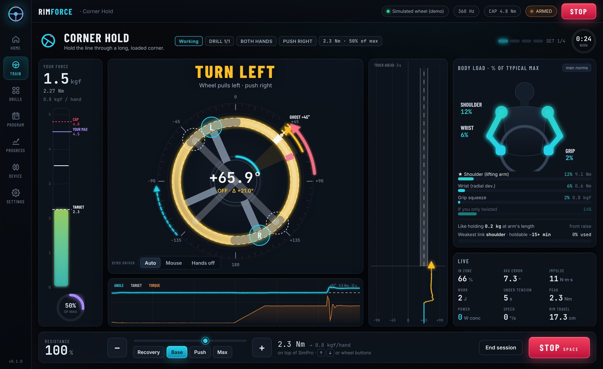
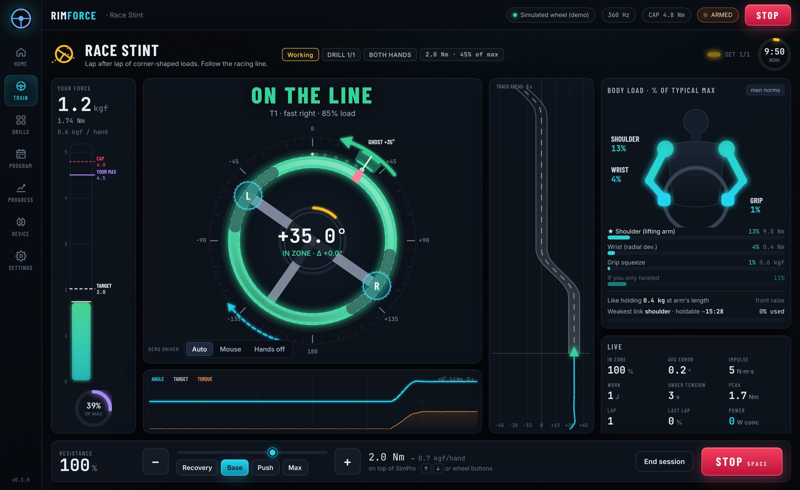
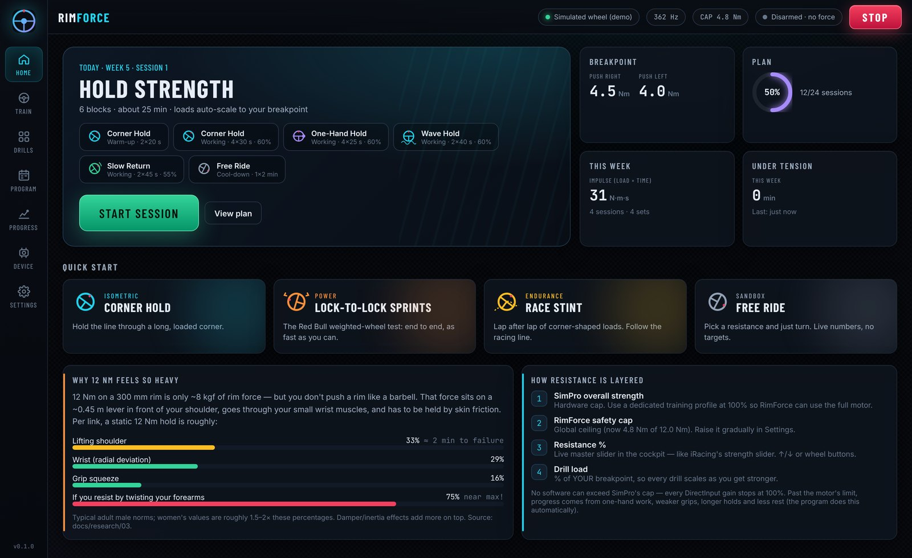
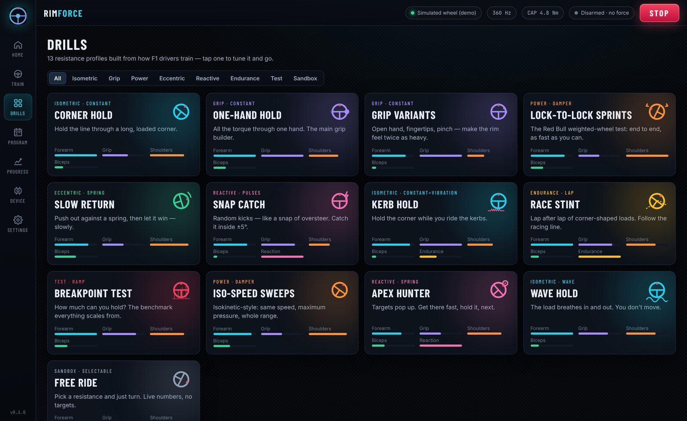
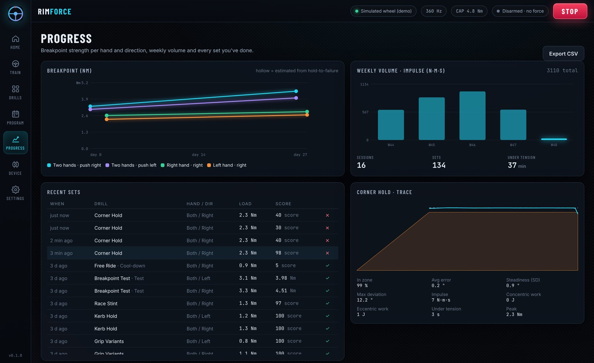

# RimForce

**Turn a direct-drive sim wheel into an F1-style steering strength trainer.**
Holds, sprints, eccentrics, reaction drills and lap-shaped race stints on your Simagic Alpha EVO, with a grey **ghost wheel** that shows exactly where you should be, a **track-ahead road** of what's coming, and live readouts of what your **shoulders, wrists, forearms and grip** are doing.



| | |
|---|---|
|  |  |
|  |  |

*Screenshots are the real UI running against the simulated wheel (dev host with `--seed`).*

> ⚠️ Built and tested in the cloud against a physics simulator. **No hardware behaviour has been verified on a real wheel yet** — run [`docs/ON-DEVICE-CHECKLIST.md`](docs/ON-DEVICE-CHECKLIST.md) first, at low strength.

---

## Download & run (Windows 10/11, x64)

1. Open the repository on GitHub → **Actions** → the latest green **build** run on your branch.
2. Scroll to **Artifacts** → download **RimForce-win-x64** (a zip).
3. Unzip anywhere and run **`RimForce.exe`**. It is self-contained: no .NET install needed. The UI uses the WebView2 runtime that ships with Windows 11 (if missing, RimForce opens the UI in your browser instead).
   - Windows SmartScreen may warn because the exe is unsigned → *More info* → *Run anyway*.
   - `RimForce.exe --demo` runs with the simulated wheel (nothing physical moves).
   - `RimForce.exe --selftest` checks start-up without force and writes `%LOCALAPPDATA%\RimForce\selftest.txt`.
4. Data lives in `%LOCALAPPDATA%\RimForce\` (`rimforce.db`, `rimforce.log`). CSV exports go to `Documents\RimForce\`.

Pushing a tag like `v0.1.0` also attaches `RimForce.exe` to a GitHub Release.

## First run (do this at low strength)

1. **SimPro Manager:** create a profile **RimForce** — overall strength **100 %**, rotation **900°**, mechanical damper/friction/inertia low. RimForce does all scaling itself (exactly like iRacing does on top of SimPro).
2. Close iRacing / irFFB / MAIRA / SimHub FFB — only one app can drive the motor.
3. Start RimForce → the first-time setup walks you through the **safety checklist**, your **wheel** (EVO 9/12/18 Nm, SimPro %, rim size, rotation), **you** (norms, technique), and the **force direction check** (hands off).
4. **Device page:** set centre, then feel each effect alone at 3–5 %.
5. Run a **Breakpoint Test** — every drill load scales from it.
6. **Home → Build my plan** and follow the ghost.

## How difficulty works (and "is it really only 8 kg?")

12 Nm on a 300 mm rim *is* ~80 N ≈ 8 kgf of rim force — but that number is misleading. The force sits on a ~0.45 m lever in front of your shoulder, passes through small wrist muscles and has to be held by skin friction. For a static 12 Nm hold the research (docs/research/03) puts it at roughly:

| Link | Typical man | Typical woman |
|---|---|---|
| Lifting shoulder | ~33 % of max (≈ 2 min to failure) | ~60 % |
| Wrist (radial deviation) | ~29 % | ~48 % |
| Grip squeeze | ~11–20 % | ~18–29 % |
| If you resist by **twisting your forearms** | **~75 %** | **> 100 %** |

So 12 Nm is endurance work for the shoulders but real strength work for wrists, forearms and grip, and dampers/inertia add more when you move fast. RimForce shows these per-link numbers **live** in the cockpit body map.

Resistance is layered like a sim game on top of the wheelbase:

1. **SimPro overall strength** — the hardware cap. No software can exceed it: every DirectInput gain tops out at 100 %. Use 100 % in the RimForce profile.
2. **RimForce safety cap** — global ceiling, **40 % on first run**; raise it gradually in Settings.
3. **Resistance %** (10–150 %) — the live master slider in the cockpit, like iRacing's strength. `↑`/`↓`, presets (Recovery / Base / Push / Max) or bind wheel buttons.
4. **Drill load** — % of *your* breakpoint, so drills get heavier as you get stronger.

Past the motor's limit you still progress: one-hand work, weaker grips (open hand / fingertips / pinch), longer holds and less rest. The 8-week program switches to longer work time automatically when a load would exceed the cap, and the Breakpoint Test switches to hold-to-failure + Rohmert's endurance curve when you're stronger than the cap.

## Training modes

| Drill | Resistance | Trains | What you do |
|---|---|---|---|
| Corner Hold | constant | forearm, shoulders | hold 0/45/90° in a ±3° zone |
| One-Hand Hold | constant | **grip**, forearm | same with one hand at 3 or 9 o'clock (press / lift cue) |
| Grip Variants | constant | **grip** | open hand → fingertips → pinch (auto lighter) |
| Lock-to-Lock Sprints | damper | shoulders, power | the Red Bull weighted-wheel test: marker to marker, count reps |
| Slow Return | spring | eccentric shoulders/forearms | turn out, hold, follow the ghost back over 3–4 s |
| Snap Catch | random pulses | wrist stability, reaction | keep it inside ±5° while it kicks |
| Kerb Hold | constant + vibration | grip endurance | hold while riding "kerb strikes" |
| Race Stint | lap profile | endurance | 10–40 min of corner-shaped loads; follow the racing line (High-speed or Street lap) |
| Breakpoint Test | ramp 1 %/s | benchmark | hold 0° until the wheel slips > 5° for 0.5 s; per hand and direction |
| Iso-Speed Sweeps | damper tuned to a speed | isokinetic-style | stay with a ghost sweeping at fixed °/s |
| Apex Hunter | spring | reaction, shoulders | hit random apex targets and hold 1 s |
| Wave Hold | wave / pyramid / random | force control | hold still while the load breathes |
| Free Ride | pick: constant, bungee, water, sand, wave, kerbs, everything | play | live numbers, no targets |

Every set is scored and logged (time in zone, error, steadiness, impulse N·m·s, concentric/eccentric work, power, time under tension, reps/laps/hits…).

## The cockpit

- **Wheel:** your real wheel (glows green in zone, amber off), the **grey ghost** hovering where it should be, the target zone on the bezel, upcoming targets as fading dots, a red arrow for where the wheel pulls and a dashed cyan arrow for where you push, hand markers with *LIFT/PRESS* cues.
- **Track ahead:** the next 3–6 s of targets scroll towards you like a road; your trail is below the line.
- **Your force:** Nm, kgf (total and per hand) against TARGET, YOUR MAX and CAP.
- **Body load:** shoulder / wrist / grip / forearm-twist as % of typical max, "like holding X kg at arm's length", weakest link and Rohmert endurance budget.
- **Telemetry:** 12 s trace of angle vs target and torque.
- Voice + sound cues for 3-2-1, go, rest, reps, laps and safety stops. Keys: **Space/Esc = STOP**, **Enter = start/next**, **↑/↓ = resistance**.

## Safety

All force passes through one `SafetyGovernor` (tests in `tests/RimForce.Tests/SafetyGovernorTests.cs`):

1. No force until **Arm & start**; Space / Esc / STOP, **Pause/Break (global, from any window)**, focus loss (strict mode — or keep running in the background like iRacing), any device error or disconnect → immediate stop.
2. Global cap (40 % default, ≤ 100 %) and per-drill caps.
3. Soft start ≥ 1.5 s, soft end 0.3 s, open-loop changes no faster than full cap in 80 ms.
4. Hands-off: > 400 °/s for > 50 ms with force on → stop. Plus runaway detection (motor spinning the wheel > 180 °/s) and an overspeed fade.
5. Stop 20° before the lock.
6. Independent watchdog thread: force loop stalls > 100 ms → StopAll. UI frozen > 1.5 s → stop.
7. No mode drives the wheel to a position; only short ramped pulses.
8. One-time checklist, mandatory force-direction check on real hardware, device tests capped at 10 %.

See [`DECISIONS.md`](DECISIONS.md) for the reasoning and every deviation from the original brief.

## Build from source

Requirements: .NET 10 SDK, Node 22.

```bash
cd ui && npm ci && npm run build && cd ..          # UI → ui/dist (embedded into the exe)
dotnet test tests/RimForce.Tests                   # 90 tests, run on Linux or Windows
dotnet publish src/RimForce.App -c Release -r win-x64 --self-contained -p:PublishSingleFile=true -o publish
```

The Windows projects build on Linux too (`EnableWindowsTargeting`).

**Try the UI without a wheel (any OS):**

```bash
dotnet run --project src/RimForce.DevHost -- --port 5180 --token dev --ui-dir ui/dist [--seed]
# open http://127.0.0.1:5180/?token=dev   (--seed fills 4 weeks of simulated history)
```

## Architecture

```
ui/                      React + TypeScript (Vite): canvas wheel, runway, meters, pages
src/RimForce.Core        net10.0, no Windows deps: safety governor, force loop, simulator + virtual driver,
                         13 drills, session runner, strength math, 8-week program, SQLite storage, app controller
src/RimForce.Server      loopback Kestrel: static UI + token-protected WebSocket bridge
src/RimForce.DirectInput Windows: Vortice.DirectInput device (one software-rendered constant-force effect)
src/RimForce.App         Windows exe: WinForms window + WebView2, focus → safety, --selftest, --demo
src/RimForce.DevHost     dev/demo host with the simulated wheel (+ --seed)
tests/RimForce.Tests     xUnit: safety rules, simulator integration (let-go → stop < 100 ms), drills, program, storage, server
docs/research/           F1 training, DirectInput FFB, torque biomechanics (with sources)
```

## Research

- [`docs/RESEARCH.md`](docs/RESEARCH.md) — summary
- [`docs/research/01-f1-driver-training.md`](docs/research/01-f1-driver-training.md)
- [`docs/research/02-directinput-ffb.md`](docs/research/02-directinput-ffb.md)
- [`docs/research/03-torque-biomechanics.md`](docs/research/03-torque-biomechanics.md)

*RimForce is a personal training tool, not medical advice. Stop on sharp joint pain (as opposed to muscle burn), keep thumbs outside the spokes, and raise the cap gradually.*
